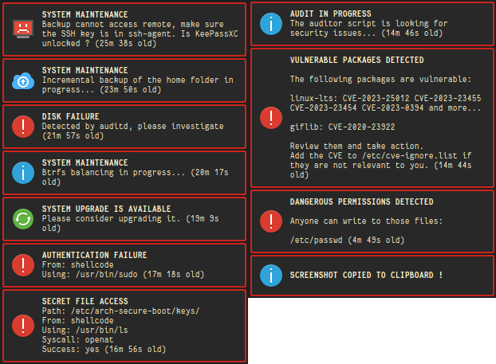

# ArchLinux Hardened

This repository contains my ArchLinux setup which focuses on desktop security.

Beside security, my setup also aims to use all the bleeding edge and state of the art software we currently have available, most notably:

- Btrfs : [copy-on-write](https://en.wikipedia.org/wiki/Copy-on-write) filesystem with snapshot support
- Wayland : because X11 is old, slow, and insecure
- NFTables : because firewalling with iptables syntax sucks

Because of its hardened nature, you might have to get your hands dirty to get things to work.
Therefore this setup is not recommended if you don't have good GNU/Linux knowledge already.

## Highlights

Physical tampering hardening:

- Secure boot without Microsoft's keys
- No GRUB-like bootloader, the kernel is booted into directly thanks to [unified kernel images](https://wiki.archlinux.org/title/Unified_kernel_image)
- Full disk encryption using LUKS 2

Exploit mitigation:

- GrapheneOS' hardened kernel
- Kernel's lockdown mode set to "integrity"
- Firejail + AppArmor (see [FIREJAIL.md](docs/FIREJAIL.md) for the why)

Network hardening:

- Strict firewalling rules (drop everything by default, see [NETWORKING.md](https://github.com/ShellCode33/ArchLinux-Hardened/blob/master/docs/NETWORKING.md))
- Reverse Path Filtering set to strict
- ICMP redirects disabled
- The hardened kernel has very strong defaults regarding network security

System monitoring:

- Auditd reporting through desktop notifications
- Many systemd services helping you to manage your system to keep it secure
- Firewall denials notifications

System resilience:

- LTS kernel fallback from the BIOS to fix a broken system
- Automated encrypted backups uploaded to a remote server (manual configuration required)
- Automated encrypted incremental backups to an external USB drive (manual configuration required)

This setup uses desktop notifications extensively, I think this is a good way of monitoring your PC.

I want to know what's going on at all times, if something fails I want to be aware of it as soon as possible in order to fix it.

Here's a sample of notifications you might get:



## Installation

Head over to [INSTALL.md](docs/INSTALL.md)

## Keeping an existing installation in sync

The installer is meant for a fresh installation. To update an existing system's configuration,
use `./sync` from this repository instead.

```sh
$ ./sync
```

By default it only previews changes. It compares the Git-tracked files in `rootfs/` with your
installed files and writes a private `.diff` file, telling you where to find it. Open it in
your editor or pager and have a look before applying anything !

It uses your local changes too, even if you haven't committed them yet. New files must be
added with `git add` first; untracked files are ignored with a warning.

If the preview reports anything it couldn't check due to permissions, try `sudo ./sync`.
Once you are happy with the diff:

```sh
$ sudo ./sync --apply
```

It asks for confirmation, then copies the proposed configuration while preserving existing file
permissions. You might need to reload or restart affected services afterwards.

It also warns about package list differences, Btrfs layout differences, package file permissions
and leftover configuration removed from Git (checked against package defaults when available).
Those warnings are for you to investigate, the script won't fix them or delete old files.

User configuration lives separately in [my dotfiles](https://github.com/ShellCode33/.dotfiles).
`./sync` doesn't update it. See `./sync --help` for the other options.

## Additional documentation

- [My threat model](/docs/THREAT_MODEL.md)
- [Manage SSH and GPG secrets securely without a password thanks to KeePassXC](docs/HOW_TO_MANAGE_SECRETS.md)
- [Setup an auto-mounted encrypted standalone USB device](docs/HOW_TO_SECURE_USB_DEVICE.md)
- [Firefox hardening tips](docs/HOW_TO_FIREFOX.md)
- [FAQ and troubleshooting](docs/FAQ_AND_TROUBLESHOOTING.md)
